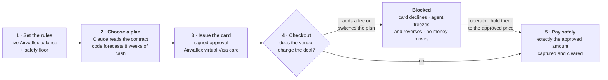
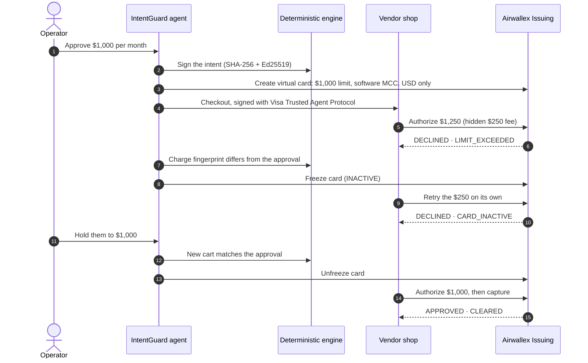
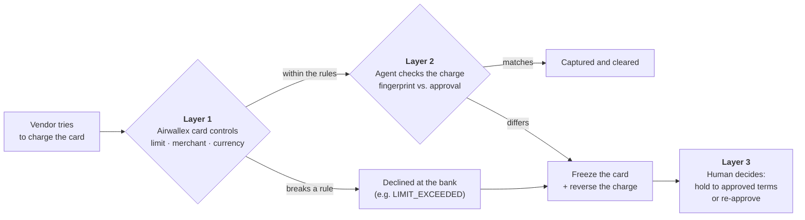
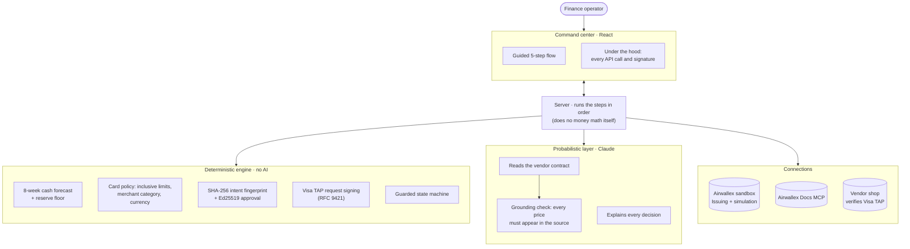

# IntentGuard

**An AI purchasing agent that checks future cash before it buys, can only spend what a human approved, and freezes its own card when a vendor changes the deal.**

IntentGuard buys software subscriptions for a finance team. Claude reads the vendor's contract. Deterministic code forecasts 8 weeks of cash for every billing option and picks the cheapest one that never drops below a safety floor. A human approves those exact terms, and the agent gets an **Airwallex virtual Visa card** that can pay only that. It checks out with requests signed under the **Visa Trusted Agent Protocol**. If the vendor adds a fee or switches the plan at payment time, the card declines it, the agent freezes the card, and nothing is paid until a human decides.

> **Demo video:** a 5-minute narrated walkthrough recorded against the live Airwallex sandbox, including the real Airwallex dashboard, built by [`video/`](video/) (Kokoro voice, burned-in captions).

> **Track:** Starter Kit 2, Intent-Bound Purchase Agent (Airwallex Issuing card controls), using the reserve-floor logic of Starter Kit 1 and a Visa TAP checkout. **Verified live** on the Airwallex sandbox.

## The problem

1. **Liquidity-blind discounts.** "20% off if you pay yearly" looks smart until it leaves the account short when payroll lands weeks later.
2. **Prompts can't enforce money rules.** Tell an AI "spend at most $1,000" and a vendor can still slip in a $250 fee at checkout. Limits must be enforced by code and by the card itself.
3. **Merchants block bots.** Shops reject automated buyers that can't prove who they are.

## How it works



| Step | What happens | Who decides |
|---|---|---|
| **1. Set the rules** | Read the live Airwallex USD balance (`GET /api/v1/balances/current`) and set the safety floor | Operator |
| **2. Choose a plan** | Upload the vendor's order form. Claude extracts prices and risky clauses; code verifies every figure is in the document. The engine forecasts 8 weeks: *yearly $9,600 upfront drops cash to $36,400 in week 7, below the $40,000 floor; monthly keeps the low point at $44,000*. It picks monthly and schedules a week-8 re-check | Deterministic engine |
| **3. Issue the card** | The operator's Ed25519 signature is bound to the SHA-256 intent. Airwallex issues a virtual card with inclusive `PER_TRANSACTION` and `MONTHLY` limits of $1,000, MCC 5734 only, USD only | Operator + engine |
| **4. Stop the overcharge** | At checkout the vendor adds a $250 fee or switches the plan. Airwallex declines over-limit charges; the agent detects the intent mismatch, freezes the card, reverses anything the rail let through, and looks up the decline code in Airwallex's docs (Docs MCP) | Airwallex card controls + engine |
| **5. Pay safely** | The operator holds the vendor to the approved terms. The cart must match the intent again before the card is released; then exactly $1,000 is authorized, captured and cleared | Engine state machine |

### What happens at checkout



### Three layers of protection



The card limit catches overcharges without any AI involved. The fingerprint check catches what limits can't, such as a switch to a cheaper but unapproved plan. The human always makes the final call.

## Architecture: deterministic vs. probabilistic



| Package | Role | Uses AI? |
|---|---|---|
| `packages/deterministic-engine` | Integer-cent money math, 8-week forecast, plan rule, Airwallex card policy and shadow evaluator, SHA-256 intent and binding hashes, Ed25519 approvals, Visa TAP signer and verifier, guarded state machine, `request_id` ledger | **No** |
| `packages/cognitive-agent` | Claude reads contracts (schema-validated structured output, grounded against the source) and writes explanations whose every dollar figure is checked against engine facts | Yes, Claude Opus 5.5 via the Anthropic API or headless Claude Code |
| `packages/simulation-adapter` | Live Airwallex sandbox client, a labelled offline emulator with the same interface, the issuing simulation wrapper, the Airwallex Docs MCP client, and the mock vendor shop with a TAP verifier | No |
| `packages/server` | Runs the five steps in order, handles contract uploads, streams telemetry to the UI | No |
| `packages/command-center-ui` | Guided 5-step React flow plus an "Under the hood" drawer with every API call | No |

More detail, including the state machine, is in [docs/ARCHITECTURE.md](docs/ARCHITECTURE.md). The pitch is in [docs/PITCH.md](docs/PITCH.md).

**Rules this code enforces** (from the Airwallex builder guide):

- The LLM never does arithmetic, enforces a limit, checks the floor, or moves the state machine. Claude's extraction is treated as untrusted input. A price that is not in the document, or a quote that is not verbatim, blocks the plan. Code recomputes the annualized cost.
- Amounts are in major units. Internally all math uses integer cents, so float drift cannot change a floor decision.
- Every `POST` gets a fresh UUIDv4 `request_id`. A ledger throws if an id is reused for a different operation.
- `authorization_controls.allowed_transaction_count` is always set. Per-transaction limits are **inclusive**: $1,000.00 passes and $1,000.01 is declined (tested). A `PER_TRANSACTION` limit is not cumulative, so a `MONTHLY` limit is added to block split charges ($600 + $650).
- Simulation mapping: `failure_reason` or `DECLINED` maps to `FAILED`. `AUTHORIZATION` + `APPROVED` means funds reserved. `CLEARING` + `APPROVED` means accepted.
- REST cardholders use `type`. The Airwallex MCP tool uses `cardholder_type`. Separate mappers handle each.
- Defense in depth: before paying, the cart hash must match the intent. After the merchant authorizes, the observed charge hash must match the intent. If the rail ever approves a charge that the deterministic policy says it should decline, the mismatch is flagged and the authorization is reversed before clearing.

### Visa Trusted Agent Protocol

`visaTap.ts` implements the open TAP wire format from [github.com/visa/trusted-agent-protocol](https://github.com/visa/trusted-agent-protocol):

- RFC 9421 HTTP Message Signatures over `("@authority" "@path")`, signed with Ed25519.
- Parameters `created`, `expires`, `keyid`, `alg`, `nonce` and `tag`. The tag is `agent-browser-auth` for browsing and `agent-payer-auth` for checkout.
- The signature window is at most 8 minutes, and nonces are single-use.
- The checkout body carries an `agenticPaymentContainer` signed with the same nonce.

The mock merchant verifies all of this at its edge. It looks up keys through a key-directory stand-in (`GET /registry/keys?keyID=`), and unsigned bots get HTTP 403 (try **"try unsigned bot"** in the UI).

`intentBinding` inside the payment container is an IntentGuard extension, not part of the TAP spec. Production TAP needs Visa onboarding and keys published in Visa's directory. This repo shows the protocol against a merchant we control.

## Run it

### The easy way: ask Claude Code to run it

If you use [Claude Code](https://claude.com/claude-code), let it set everything up and run the full flow for you:

```bash
git clone https://github.com/Shivam-sopho/intentguard.git
cd intentguard
claude
```

Then paste this prompt:

```text
Set up and run IntentGuard, following CLAUDE.md. Install dependencies, run the tests, start the app,
then run the full flow end to end: upload a sample contract PDF, choose the plan, issue the card,
let the vendor add a hidden fee so it gets blocked, settle at the approved price, and refund.
Summarise what happened at each step, then tell me what to open in the browser.
```

Claude Code reads [`CLAUDE.md`](CLAUDE.md), which tells it how to:
- install the dependencies and run the 40 tests;
- start the API and UI;
- drive all the steps through the API, including the PDF upload, the blocked $250 fee, settlement and the refund;
- explain the result and hand you the UI at http://localhost:5173.

Without Airwallex keys it runs on the labelled offline emulator. To see it on the **live Airwallex sandbox**, put your own sandbox keys in `.env` yourself (Claude will ask you to; never paste keys into the chat), and Claude will check them with `npm run sandbox:check` first. If you also connect the Airwallex Developer MCP, you can ask Claude to audit the transactions the run created.

### Manually

```bash
npm install
cp .env.example .env        # optional: add Airwallex sandbox + Anthropic keys
npm run dev                 # API :8787 + UI http://localhost:5173
```

The UI walks through the story one step per screen, with one action per step. Click **Auto-play demo** to play it all, or step through by hand. **Under the hood** opens a drawer with every Airwallex call, TAP signature, engine decision and state transition, for judges who want the raw evidence.

| Command | What it does |
|---|---|
| `npm test` | 40 unit tests: Week-7 breach math, inclusive limits, split-charge block, hash drift, cadence flip, approval binding, TAP replay/path/expiry/key/nonce attacks, state-machine guards, LLM grounding, PDF extraction, emulator refund/reversal semantics |
| `npm run demo:cli` | Headless end-to-end run of all five acts against a running API |
| `npm run sandbox:check` | Read-only probe of your Airwallex sandbox credentials (login, balances, Issuing) |
| `npm start` | Production build of the UI served by the API on :8787 |

**No Anthropic API key needed.** If the `claude` CLI is installed and logged in, the agent's language work (reading the quote, explaining decisions, writing reports) runs through Claude Code in headless mode (`claude -p`). It runs with all tools disabled, no MCP servers, no saved session and an empty working directory, so a prompt injection hidden in a vendor document has nothing to act on. Its structured output is validated with the same schema and grounding checks as the API path. Set `ANTHROPIC_API_KEY` to use the Anthropic API instead.

**Modes are always labelled.** The header and every telemetry line show whether calls hit the **live Airwallex sandbox** or the **offline emulator**, and whether text came from **Claude** or an **offline template**. The emulator only runs when no credentials are configured or the sandbox is unreachable. It follows the documented Airwallex response shapes and semantics.

**Live balance and the floor.** With sandbox credentials, the opening balance is your real USD wallet. The default reserve floor is the opening balance minus $18,000, which recreates the scenario's Week-7 squeeze for any balance. You can set the floor yourself in Act 1.

## Verified live on the Airwallex sandbox

Every step runs against `api.sandbox.airwallex.com` with a US-registered sandbox organisation. These all succeed:
- cardholder creation, virtual card creation with controls, and reading limits back;
- simulated authorizations, with Airwallex itself returning `DECLINED` + `LIMIT_EXCEEDED` for the over-limit charge and `CARD_INACTIVE` for the frozen card;
- freezing and unfreezing the card;
- reversal, capture (`CLEARING`) and refund.

The engine's predicted decision agreed with Airwallex's on every charge.

Live behaviour the code handles:
- **Single-use cards are consumed by their first approved authorization, even after a reversal.** Airwallex then closes the card. When that happens, the agent issues a replacement card bound to the same signed approval instead of unfreezing.
- **Card issuing and the Developer MCP depend on the organisation's country.** An India-registered sandbox org got `Invalid issuance details` on card creation and "Connections are not available in your region" from the Developer MCP. Use an org registered in a country where Airwallex issues cards (AU, CA, EEA, HK, IL, MY, NZ, SG, UK, US).

## Upload any vendor contract

Step 2 takes the vendor's order form or terms as a PDF, `.txt` or `.md` file (up to 8 MB). PDF text is extracted deterministically with `unpdf`, and that same text is what Claude reads and what the grounding check verifies against. The mock merchant serves the uploaded document and prices its cart from it, so the whole flow runs on your contract.

Three sample order forms are in `samples/` (and one click away in the UI). Each leads to a different decision:

| Sample | Yearly vs monthly | Agent's decision |
|---|---|---|
| `cloudscale-order-form.pdf` | $9,600 upfront vs $1,000/mo | Yearly breaks the floor in week 7, so it picks **monthly** |
| `northbeam-analytics-order-form.pdf` | $14,400 upfront vs $1,400/mo | Yearly breaks the floor in week 4, so it picks **monthly** |
| `pagelight-status-order-form.pdf` | $3,000 upfront vs $300/mo | Both are safe, so it picks the cheaper **yearly** |

At checkout you choose how the vendor misbehaves:
- **Adds a fee:** the card limit declines it at the rail.
- **Switches the plan:** when the new price is under the limit, the rail approves it. The agent's intent-hash check catches the plan change, freezes the card and reverses the authorization before it clears.

After settlement you can simulate a refund (`POST /api/v1/simulation/issuing/refund`), which restores the card's limit. The week-N re-evaluation downloads as a calendar file (`/api/trigger.ics`).

## Airwallex MCP

- **Docs MCP (used at runtime):** when a charge is declined, the agent calls `search_public_docs` on `https://mcp.sandbox.airwallex.com/docs`. It looks up the decline code (for example `LIMIT_EXCEEDED`) in Airwallex's "Transaction failure reasons" table and cites it in the incident report and on screen.
- **Developer MCP:** this needs an interactive OAuth sign-in, so the app doesn't call it directly. We connected it in Claude Code (`claude mcp add-json airwallex-dev '{"type":"http","url":"https://mcp.sandbox.airwallex.com/developer"}'`, then `/mcp`) and used it to independently audit the agent's live runs. `list_issuing_transactions` and `retrieve_card` show the same $1,250 `LIMIT_EXCEEDED` decline, the `CARD_INACTIVE` retry, the `CLEARED` $1,000, and the single-use card `CLOSED` after a reversal.

## Scenario numbers (verified by tests)

Opening $58,000 · floor $40,000 · opex −$1,000/week · week 7 payroll + payroll tax −$5,000 · week 8 receivable +$18,000.

| Week | 1 | 2 | 3 | 4 | 5 | 6 | **7** | 8 |
|---|---|---|---|---|---|---|---|---|
| Annual ($9,600 in W1) | 47,400 | 46,400 | 45,400 | 44,400 | 43,400 | 42,400 | **36,400 ✗** | 53,400 |
| Monthly ($1,000 in W1, W5) | 56,000 | 55,000 | 54,000 | 53,000 | 51,000 | 50,000 | **44,000 ✓** | 61,000 |

Annual saves 20% ($2,400 a year) but breaches the floor by $3,600 in week 7. Switching to annual in week 8 keeps every week at or above $44,000, so the engine schedules that re-evaluation.
