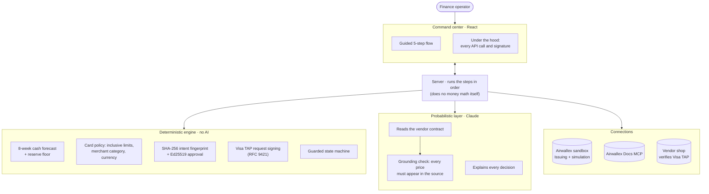
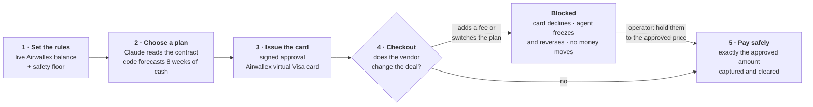
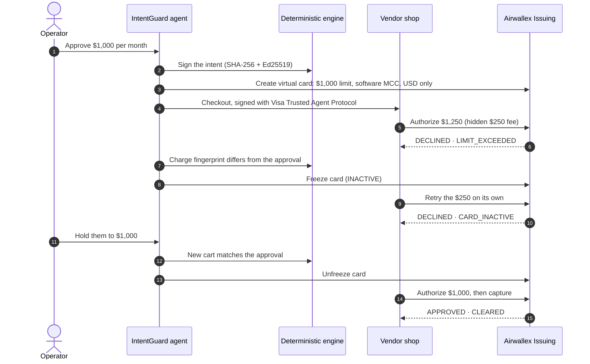
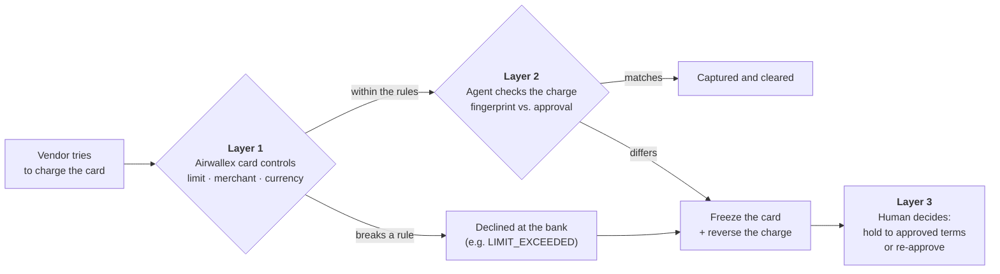
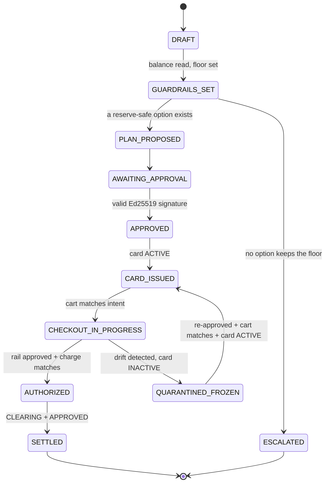

# IntentGuard architecture

This document explains how IntentGuard is put together and why. The diagrams are Mermaid, so GitHub renders them; their sources are in [`docs/diagrams/`](diagrams/).

## The core idea: AI reads, code decides, the card enforces

Every decision that moves or protects money is made by deterministic code and enforced by Airwallex's card controls. Claude is used only for the two things code can't do well: reading an unstructured contract, and explaining decisions to a human. Even then its output is treated as untrusted:
- a price Claude extracts must appear verbatim in the document, or planning stops;
- every dollar figure in Claude's explanations must match a number the engine computed.

## End-to-end flow

## Checkout, step by step

This is the live sequence recorded against the Airwallex sandbox (the vendor adds a hidden $250 fee):

When the vendor instead switches to a cheaper plan that fits under the limit, Airwallex approves the authorization. The agent's fingerprint check catches it, freezes the card and reverses the authorization before it clears. On a single-use card Airwallex then closes the card, so the agent issues a replacement bound to the same signed approval.

## Defense in depth

| Layer | Enforced by | Catches |
|---|---|---|
| 1. Card controls | Airwallex Issuing (`authorization_controls`) | Anything over the inclusive limit, the wrong merchant category, the wrong currency, or after expiry |
| 2. Intent fingerprint | Deterministic engine (SHA-256 over merchant, MCC, amount, currency, cadence) | Any change to the approved terms, including ones the card limit allows |
| 3. Human decision | Operator, with a signed Ed25519 re-approval | The card stays frozen until a person decides |

## State machine

Every transition is guarded by code; an illegal jump (for example, settling without a cleared capture) throws.

## Trust boundaries

| Input | Treated as | Protection |
|---|---|---|
| Vendor contract (PDF/text) | Untrusted | Text extraction is deterministic; Claude runs with **no tools** (no shell, files, web or MCP), so prompt injection in a contract has nothing to act on; extracted prices must be verbatim in the source |
| Claude's output | Untrusted | Zod schema validation, grounding checks, code recomputes every total |
| Vendor's charges | Untrusted | Card controls at the rail plus the fingerprint check on every authorization |
| Merchant requests from the agent | Authenticated | Visa TAP: RFC 9421 Ed25519 signatures, 8-minute window, single-use nonces, signed payment container |
| Operator approval | Authenticated | Ed25519 signature over the exact intent hash |
