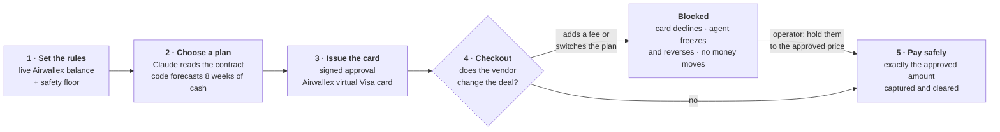
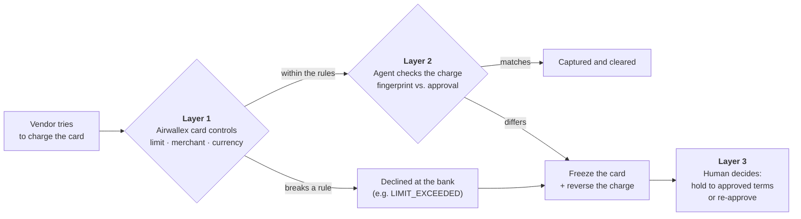

# IntentGuard: Liquidity-Aware SaaS Procurement with Airwallex Card Controls and Visa Trusted Agent Protocol Checkout

## Executive summary

IntentGuard is a procurement agent that buys SaaS subscriptions without putting the company's cash at risk. It reads the vendor's order form, then deterministic code projects the next 8 weeks of cash for every billing option and picks the cheapest one that never drops below a hard reserve floor. A human approves those exact terms, and the agent gets an Airwallex virtual card whose controls only allow that charge. It checks out with requests signed under the Visa Trusted Agent Protocol (TAP).

If the merchant changes the deal mid-checkout, IntentGuard stops it: an added fee, a different amount, or a switch from monthly to yearly billing. The card controls decline anything over the limit at the rail, and the agent detects the SHA-256 intent mismatch on every charge. It then freezes the card, reverses any authorization the rail let through, and waits for the operator to decide.

## Problem

1. **Liquidity-blind discount traps.** A 20% discount for paying yearly upfront looks optimal in isolation, but it can push operating cash below the safety reserve weeks later.
2. **Prompt-based policy leaks.** An LLM told "don't spend more than $1,000" can be talked around, or simply miss a fee injected at payment time. Spending limits must be enforced by code and by the card rail, not by a prompt.
3. **Merchant bot rejection.** Merchants block automated checkout unless the agent proves who it is. Visa's Trusted Agent Protocol gives agents a verifiable cryptographic identity.

## How it works (5 steps)

1. **Set the rules.** The agent reads the live Airwallex balance (`GET /api/v1/balances/current`). The operator sets a reserve floor for the next 8 weeks.
2. **Choose a plan.** The operator uploads the vendor's order form (PDF or text). The agent fetches it over a TAP `agent-browser-auth` request, and Claude extracts the billing options and risky clauses.
   - **Grounding:** code rejects any price or quote that isn't verbatim in the document.
   - **Projection:** the deterministic engine projects cash week by week.
   - **Decision:** in the CloudScale example, yearly ($9,600 upfront) drops cash to $36,400 in week 7, $3,600 below the $40,000 floor, so the engine picks monthly ($1,000/month, low point $44,000).
   - **Re-evaluation:** it schedules a week-8 check (with a calendar file) for when an $18,000 receivable lands.
   - **Approval:** the operator signs the SHA-256 intent hash with Ed25519.
3. **Issue the card.** IntentGuard calls `POST /api/v1/issuing/cardholders/create` and `POST /api/v1/issuing/cards/create`. The card has:
   - inclusive `PER_TRANSACTION` and `MONTHLY` limits equal to the approved charge,
   - the merchant's MCC only,
   - USD only,
   - an expiry date.
   Limits are read back with `GET /api/v1/issuing/cards/{id}/limits`.
4. **Stop the overcharge.** At checkout (TAP `agent-payer-auth` plus a signed `agenticPaymentContainer`), the merchant either adds a fee or switches the billing plan.
   - The card declines over-limit charges (`LIMIT_EXCEEDED`, so the transaction is `FAILED`).
   - The agent detects the intent-hash mismatch and freezes the card (`POST /api/v1/issuing/cards/{id}/update` to `INACTIVE`). It reverses any authorization the rail approved before it can clear.
   - The merchant's retry is declined (`CARD_INACTIVE`).
   - The agent looks up the decline code in Airwallex's documentation through the **Airwallex Docs MCP**, and Claude writes the incident report.
5. **Pay safely.** The operator re-signs the original terms. The cart must match the intent hash again before the card is unfrozen. The TAP checkout is authorized, captured (`CLEARING` + `APPROVED`), and logged. A simulated refund restores the card's limit.

## Architecture: deterministic vs. probabilistic

| Layer | What it does | AI involved? |
|---|---|---|
| `deterministic-engine` | Integer-cent money math, 8-week projection with an inclusive floor, plan selection, the Airwallex card policy, a shadow evaluator of card controls, SHA-256 intent and binding hashes, Ed25519 approvals, the Visa TAP signer and verifier (RFC 9421), a guarded state machine, and the `request_id` ledger | **No** |
| `cognitive-agent` | Claude extracts pricing and clauses (structured output, validated by a schema and grounded against the source). It also writes the plan explanation, incident report and audit note; every dollar figure is checked against the engine's facts | Yes (Claude Opus 5.5, via the Anthropic API or headless Claude Code) |
| `simulation-adapter` | Live Airwallex sandbox client and a labelled offline emulator with the same interface. It wraps `/simulation/issuing/create`, lifecycle `capture` and `reverse`, and `refund`. It also holds the Airwallex Docs MCP client and the mock merchant with a TAP verifier | No |
| `command-center-ui` | A guided 5-step React and Tailwind flow, plus an "Under the hood" drawer showing every API call, signature and state transition | No |

## What judges can verify

- 40 unit tests:
  - Week-7 breach math and the inclusive limit ($1,000.00 passes, $1,000.01 fails),
  - split-charge blocking and cadence-flip detection,
  - approval binding,
  - TAP replay, path, expiry, key and nonce attacks,
  - state-machine guards,
  - grounding of LLM output,
  - PDF contract extraction and emulator refund/reversal semantics.
- Upload any order form: the three sample PDFs lead to different decisions (CloudScale and Northbeam pick monthly; PageLight picks yearly because it is safe).
- Every screen labels whether Airwallex is live or emulated, and whether the text came from Claude or a template.

## Verified live

All five steps run against the live Airwallex sandbox (US-registered org): real virtual card, real `LIMIT_EXCEEDED` and `CARD_INACTIVE` declines, freeze and unfreeze, reversal, capture and refund. The Airwallex Developer MCP independently confirms each transaction.

## Tracks

- **Primary: Starter Kit 2, Intent-Bound Purchase Agent** (Airwallex Issuing card controls).
- Uses the reserve-floor treasury logic of **Starter Kit 1**.
- **Visa Trusted Agent Protocol:** a protocol-faithful implementation against our own merchant. Production TAP requires Visa onboarding.

## Roadmap (not in this build)

- Visa Intelligent Commerce (VIC) tokenized credentials (requires Visa onboarding).
- Calling the Airwallex Developer MCP from inside the app for automated audits. Today it is used from Claude Code to cross-check live runs, because it requires an interactive OAuth sign-in.
- Starter Kits 9 and 10 (require Airi CLI or merchant enablement).
- AWS Bedrock AgentCore deployment.
